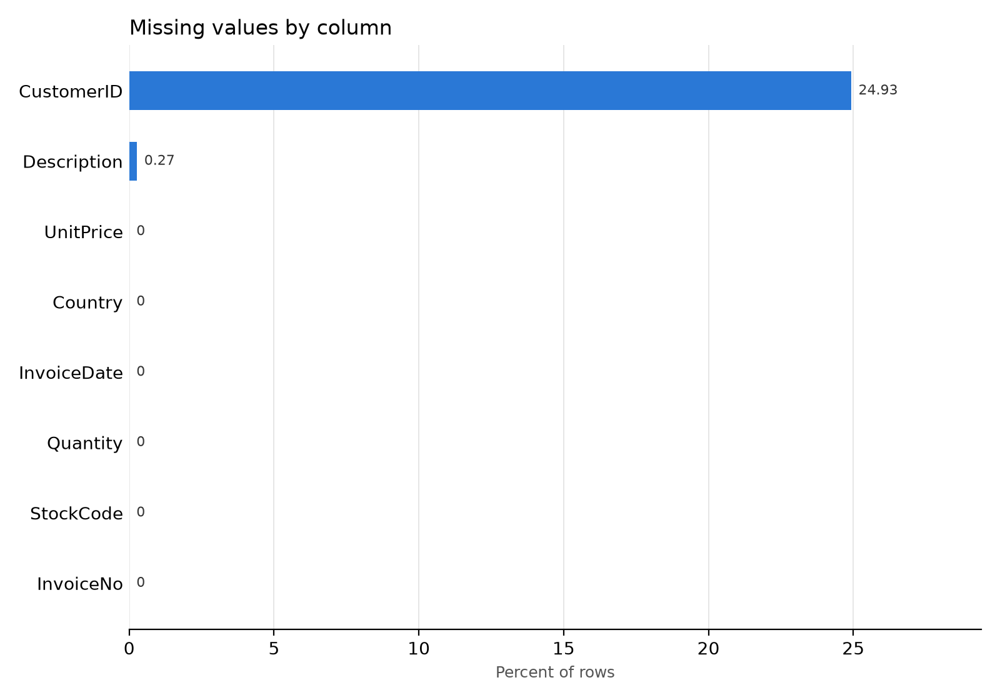
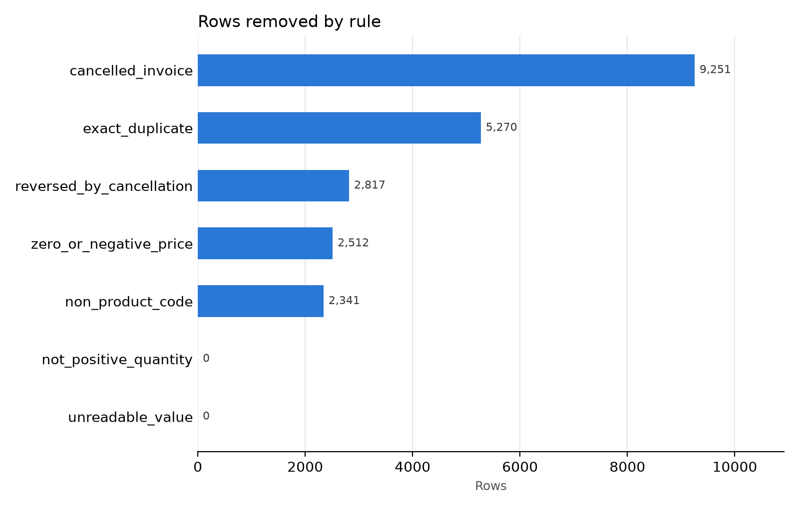
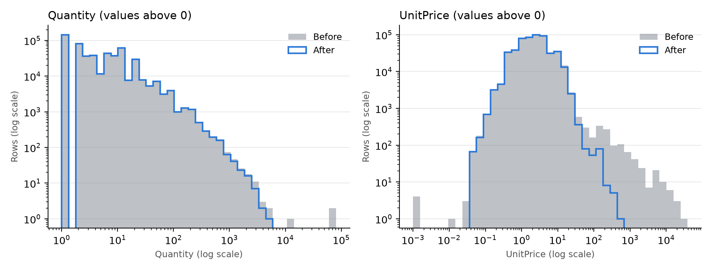

# Data Cleaning Report: Online Retail

CodeNova Data Science Internship,  Task 2.

This project takes the raw UCI Online Retail dataset, finds its data quality problems, cleans it with one repeatable script, and writes a Data Quality Audit Report that explains every decision.

## Features

- Scans for missing values, duplicate rows and invalid data types
- Detects outliers with IQR and compares them with Z-score
- Removes bad rows and saves every removed row with its reason
- Keeps real sales that have no CustomerID and marks them
- Marks outliers instead of deleting them
- Writes a before-and-after comparison, charts and an audit report
- Stops with an error if the raw file changes or the row counts do not add up

## Tech stack

Python, Pandas, NumPy, Matplotlib, OpenPyXL. All free.

## Setup and run

1. Download the dataset from the [UCI Machine Learning Repository](https://archive.ics.uci.edu/dataset/352/online+retail).
2. Put the file at `data/raw/Online Retail.xlsx`.
3. Run these commands from the project folder:

```bash
pip install -r requirements.txt
python src/clean_data.py
```

To use a different file or folder:

```bash
python src/clean_data.py --input "data/raw/data.csv" --output outputs
```

## Project structure

```text
data/raw/                 original dataset, never changed
src/clean_data.py         the full cleaning script
outputs/
  online_retail_clean.csv             all valid sales
  online_retail_clean_customers.csv   valid sales with a CustomerID
  removed_rows.csv                    every removed row and its reason
  before_after_comparison.csv         before-and-after table
  missing_values_scan.csv             missing value counts
  Data_Quality_Audit_Report.md        the full report
  charts/                             report charts
```

## Results

The full results are in the [Data Quality Audit Report](outputs/Data_Quality_Audit_Report.md).







## Reproducibility

The script uses no random steps, so the same input always gives the same output. It only reads the raw file and checks the file's SHA-256 fingerprint before and after the run.

## Dataset credit

Chen, D. (2015). Online Retail. UCI Machine Learning Repository. Licensed under CC BY 4.0.
