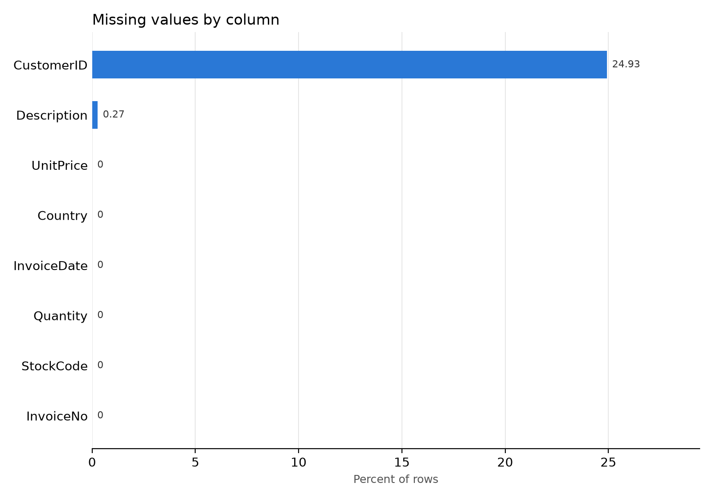
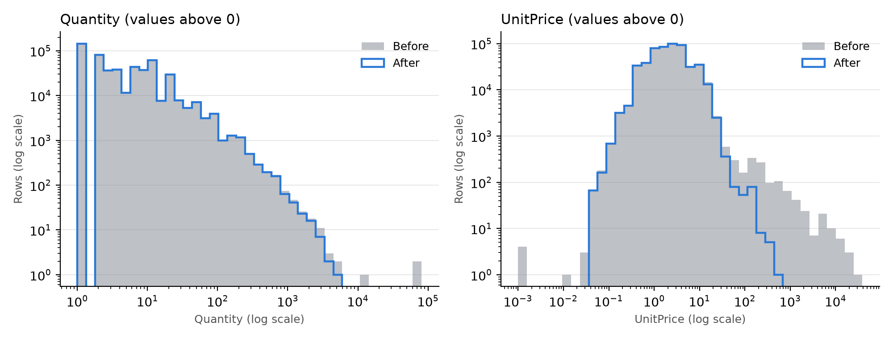
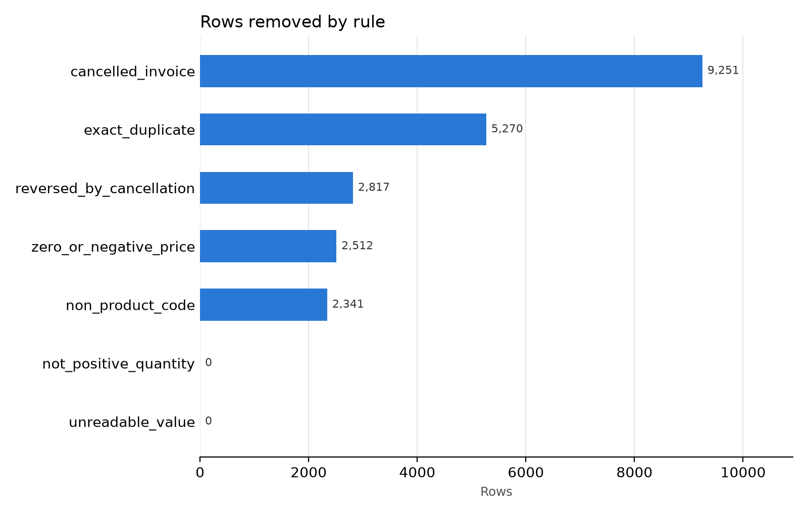

# Data Quality Audit Report

**Project:** CodeNova Data Science Internship, Batch 01, Task 2
**Dataset:** UCI Online Retail, read from `Online Retail.xlsx`
**Raw file SHA-256:** `43465a06f2ccf7c8b5bd2892bc7defb52f97487934fe93b16ae4c3936424676d`

This report is written by `src/clean_data.py`. Every number comes from the run that produced it.

## 1. Summary

- Rows went from **541,909** to **519,718**, so 22,191 rows (4.09%) were removed.
- Every removed row is saved with its reason in `outputs/removed_rows.csv`.
- The raw file was only read. Its SHA-256 fingerprint is the same before and after the run.
- 131,387 sales rows with no CustomerID are kept, because they are real sales. They make up 15.38% of cleaned revenue.

## 2. What the scan found

Rows: 541,909. Columns: 8.

### Missing values

| Column | Missing rows | Missing % |
| --- | --- | --- |
| InvoiceNo | 0 | 0.00 |
| StockCode | 0 | 0.00 |
| Description | 1,454 | 0.27 |
| Quantity | 0 | 0.00 |
| InvoiceDate | 0 | 0.00 |
| UnitPrice | 0 | 0.00 |
| CustomerID | 135,080 | 24.93 |
| Country | 0 | 0.00 |

### Duplicates and invalid data types

| Check | Result |
| --- | --- |
| Exact duplicate rows | 5,268 |
| Quantity values that are not numbers | 0 |
| UnitPrice values that are not numbers | 0 |
| InvoiceDate values that are not dates | 0 |
| CustomerID values that are not numbers | 0 |
| Cancelled rows (invoice starts with C) | 9,288 |
| Rows with negative Quantity | 10,624 |
| Negative Quantity on rows that are not cancelled | 1,336 |
| Rows with UnitPrice of 0 | 2,515 |
| Rows with negative UnitPrice | 2 |
| Stock codes as written / ignoring case | 4,070 / 3,958 |
| Descriptions as written / ignoring case | 4,211 / 4,194 |

Values with extra spaces at either end: InvoiceNo: 0, StockCode: 0, Description: 113,452, Country: 0.

Data types: InvoiceNo is text because of the C prefix. InvoiceDate was parsed to a date. CustomerID is stored as a whole number that allows blanks, so `17850.0` becomes `17850`.

## 3. Outlier detection

The main method is IQR. Lower limit = Q1 - 1.5 x IQR. Upper limit = Q3 + 1.5 x IQR. The Z-score count is shown for comparison.

| Stage | Column | Lower limit | Upper limit | IQR outliers | IQR % | Z-score outliers (over 3 std) |
| --- | --- | --- | --- | --- | --- | --- |
| Before cleaning | Quantity | -12.50 | 23.50 | 58,619 | 10.82% | 346 |
| Before cleaning | UnitPrice | -3.07 | 8.45 | 39,627 | 7.31% | 374 |
| After cleaning | Quantity | -14.00 | 26.00 | 26,732 | 5.14% | 3,923 |
| After cleaning | UnitPrice | -3.07 | 8.45 | 35,269 | 6.79% | 6,586 |

**Decision: mark outliers, do not delete them.** A large quantity is often a real wholesale order and a high price is often an expensive product. After cleaning, the outlier rows hold 45.37% of revenue (4,455,810.41), so deleting them would remove real business. They are marked in `IsQuantityOutlier` and `IsPriceOutlier`, so a later analysis can include or leave them out. Only the upper limit is used for the marks, because after cleaning all values are above zero.

The extreme values that were wrong were handled by a rule with evidence, `reversed_by_cancellation`. It removes a sale only when a later cancellation matches its customer, stock code and quantity.

## 4. Cleaning steps

### Changes that keep the row

| Change | Why |
| --- | --- |
| Removed extra spaces, made InvoiceNo, StockCode and Description upper case | The same value written two ways would be counted as two values. |
| Replaced EIRE with Ireland and RSA with South Africa | Plain country names, one name per country. |
| One Description per StockCode, the most common name (rows renamed: 6,506) | The same product should group together in later analysis. |
| Added Revenue = Quantity x UnitPrice | Needed for sales analysis. |
| Added HasCustomerID and the two outlier marks | Lets later work filter without losing rows. |

### Removal rules, in the order they run

| Rule | Rows removed | Rows left | Sales value of removed rows | Why |
| --- | --- | --- | --- | --- |
| unreadable_value | 0 | 541,909 | 0.00 | Date, Quantity or UnitPrice could not be read as a valid value, so the row cannot be used in any calculation. |
| exact_duplicate | 5,270 | 536,639 | 22,292.83 | Every column except the spelling of Description matches an earlier row, so keeping it would count the same sale twice. |
| cancelled_invoice | 9,251 | 527,388 | -893,979.73 | Invoice number starts with C, which marks a cancellation and not a sale. |
| zero_or_negative_price | 2,512 | 524,876 | -22,124.12 | Price is 0 or below, so this is a stock adjustment or note and not a sale. |
| not_positive_quantity | 0 | 524,876 | 0.00 | Quantity is 0 or below on a non-cancelled invoice, so nothing was sold. |
| non_product_code | 2,341 | 522,535 | 394,891.48 | Stock code is a fee or service charge (see NON_PRODUCT_CODES), not goods. |
| reversed_by_cancellation | 2,817 | 519,718 | 425,781.36 | A later cancellation by the same customer undid exactly this item and quantity, so the sale never really stood. |

The rows are checked in this order and each removed row gets the first rule that matched, so no row is counted twice.

### Missing value decisions

**Description (1,454 missing in raw data).** 1,454 of these rows had a UnitPrice of 0, so the price rule handles them. 0 rows reached the imputation step and were filled with the most common name for the same StockCode. 0 rows had no name to borrow and were labelled UNKNOWN PRODUCT.

**CustomerID (135,080 missing in raw data).** Not imputed. A customer ID identifies a person, so a mean or a guess would invent a customer and join their purchases to someone else. No invoice contains both a known and a missing CustomerID, so the ID cannot be recovered from other rows of the same invoice. The rows stay in the main file with `HasCustomerID = False`. `outputs/online_retail_clean_customers.csv` holds only rows with an ID, for customer analysis.

## 5. Before and after

| Metric | Before | After |
| --- | --- | --- |
| Rows | 541,909 | 519,718 |
| Total missing cells | 136,534 | 131,387 |
| Missing Description | 1,454 | 0 |
| Missing CustomerID | 135,080 | 131,387 |
| Exact duplicate rows | 5,268 | 0 |
| Rows with Quantity <= 0 | 10,624 | 0 |
| Rows with UnitPrice <= 0 | 2,517 | 0 |
| Quantity mean | 9.55 | 10.27 |
| Quantity median | 3.00 | 4.00 |
| Quantity std | 218.08 | 37.12 |
| Quantity min | -80,995 | 1 |
| Quantity max | 80,995 | 4,800 |
| UnitPrice mean | 4.61 | 3.26 |
| UnitPrice median | 2.08 | 2.08 |
| UnitPrice std | 96.76 | 4.18 |
| UnitPrice min | -11,062.06 | 0.04 |
| UnitPrice max | 38,970.00 | 649.50 |
| Total revenue | 9,747,747.93 | 9,820,886.11 |
| Unique invoices | 25,900 | 19,647 |
| Unique stock codes | 4,070 | 3,793 |
| Unique customers | 4,372 | 4,324 |
| Unique countries | 38 | 38 |

## 6. Limitations

- Exact duplicates may include a few real repeat scans of one item on one invoice. The data cannot separate those from double entries, so all exact copies are removed.
- `reversed_by_cancellation` only catches cancellations with an exact quantity match and a known customer. Partial cancellations are not matched.
- `NON_PRODUCT_CODES` is a hand-written list, so a new code in a later file would need adding.
- Revenue is in the currency of the source data and is not adjusted for tax or discounts.
